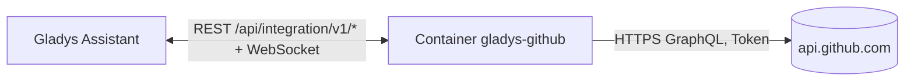
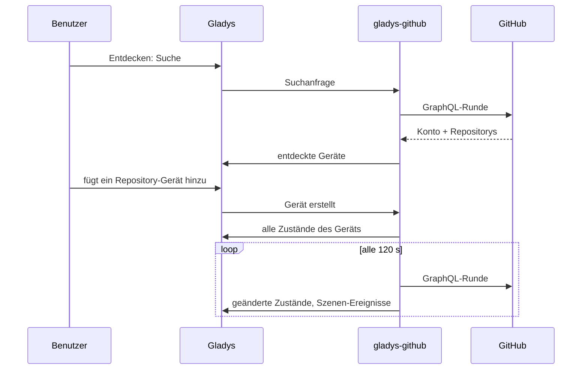

# Gladys GitHub

[English](README.md) · [Français](README.fr.md) · **Deutsch** · [Español](README.es.md)

[](LICENSE)
[](https://github.com/William-De71/gladys-github/releases)
[](https://github.com/William-De71/gladys-github/actions/workflows/release.yml)
[](https://gladysassistant.com)


Eine externe Integration für [Gladys Assistant](https://gladysassistant.com), die GitHub-Repositorys verfolgt, wie die GitHub-Integration von Home Assistant. Releases, Issues, Pull-Requests, Sterne und CI-Ergebnisse werden zu Geräten, Szenenauslösern und Dashboard-Widgets.

## Funktionen

- Ein **Gerät pro Repository**: Sterne, Forks, Beobachter, offene Issues, offene und gemergte Pull-Requests, Diskussionen, Downloads des neuesten Releases; als Text das neueste Release, Tag, Commit, Issue, Pull-Request und die neueste Diskussion.
- Ein **Gerät für dein Konto**: Follower, gefolgte Konten, öffentliche Repositorys und Gists.
- **7 Szenenauslöser**: Release veröffentlicht, Issue eröffnet, Pull-Request eröffnet, Diskussion gestartet, neuer Commit, neuer Stern, Prüfungen (CI) bestanden oder fehlgeschlagen.
- **1 Szenenaktion**: die Zahlen eines Repositorys in einer Szene lesen.
- **3 Dashboard-Widgets**: ein Repository, die neueste Aktivität, dein Konto und sein API-Limit.
- Öffentliche Repositorys und private, auf die das Token Zugriff hat. Nur lesend: Die Integration schreibt nie auf GitHub.
- Englisch, Französisch, Deutsch und Spanisch überall.

## Funktionsweise




Eine GraphQL-Anfrage pro Runde liest das Konto, das API-Limit und jedes verfolgte Repository (1 Punkt der 5.000 Punkte pro Stunde, die GitHub einem Token gewährt). Die erste Runde nach einem Start dient als Referenz: Übergänge werden ab der nächsten Runde gemeldet.



### Transport

Nur **Cloud** (`"transports": ["cloud"]`): Die Integration spricht nur mit `api.github.com`. Gladys zeigt im Katalog das Cloud-Abzeichen. Die Namen der verfolgten Repositorys und das Token verlassen dein Netzwerk in Richtung GitHub; sonst geht nichts woandershin.

## Geräte und Funktionen

| Gerät               | Funktion                                                     | Typ                          |
| ------------------- | ------------------------------------------------------------ | ---------------------------- |
| GitHub `owner/name` | Sterne, Forks, Beobachter                                    | Zähler                       |
|                     | Offene Issues, offene / gemergte Pull-Requests, Diskussionen | Zähler                       |
|                     | Downloads des neuesten Releases                              | Zähler (Release mit Dateien) |
|                     | Neuestes Release, Tag, Commit                                | Text                         |
|                     | Neuestes Issue, Pull-Request, Diskussion                     | Text                         |
| GitHub `@login`     | Follower, Folgt, Öffentliche Repositorys, Öffentliche Gists  | Zähler                       |

Die externen IDs beruhen auf den numerischen IDs von GitHub: Ein umbenanntes oder übertragenes Repository behält sein Gerät.

## Szenenauslöser, Aktion und Widgets

| Art      | Schlüssel             | Zweck                                                       |
| -------- | --------------------- | ----------------------------------------------------------- |
| Auslöser | `release_published`   | Ein Release oder eine Vorabversion erscheint (Filter: Typ)  |
| Auslöser | `issue_opened`        | Jemand eröffnet ein Issue                                   |
| Auslöser | `pull_request_opened` | Jemand eröffnet einen Pull-Request                          |
| Auslöser | `discussion_created`  | Jemand startet eine Diskussion                              |
| Auslöser | `commit_pushed`       | Ein Commit landet im Standard-Branch                        |
| Auslöser | `star_added`          | Die Zahl der Sterne steigt                                  |
| Auslöser | `checks_completed`    | Die CI des neuesten Commits besteht oder scheitert (Filter) |
| Aktion   | `get_repository`      | Sterne, Issues, neuestes Release… als Szenen-Ausgaben       |
| Widget   | `repository`          | Ein Repository auf einen Blick                              |
| Widget   | `activity`            | Neueste Releases, Issues, Pull-Requests und Commits         |
| Widget   | `account`             | Follower, Repositorys, verbleibendes API-Limit              |

Szenen-Beispiele:

- Wenn ein Release eines Projekts erscheint, das du nutzt → sende eine Nachricht mit `{{triggerEvent.data.summary}}`.
- Wenn die Prüfungen deines Projekts fehlschlagen → schalte die Bürolampe auf Rot.
- Wenn dein Repository einen Stern bekommt → spiele einen Ton auf dem Lautsprecher ab.


## Voraussetzungen

- Gladys Assistant **5.1.0** oder neuer (Widgets und Szenen externer Integrationen). Ältere Instanzen können sie nicht installieren.
- Ein persönliches GitHub-Zugriffstoken: feingranular mit „Public repositories“ (nur lesend) oder mit Lesezugriff auf die gewählten privaten Repositorys.

## Installation

- **Aus dem Store**: Integrationen → „GitHub“ suchen → Installieren.
- **Über die Repository-URL**: Integrationen → Integration installieren → `https://github.com/William-De71/gladys-github`.
- **Entwicklermodus**: Integrationen → Integration installieren → Entwicklermodus, mit dem Image `ghcr.io/william-de71/gladys-github:<version>`.

## Konfiguration

| Feld                       | Pflicht | Beschreibung                                                                                                         |
| -------------------------- | ------- | -------------------------------------------------------------------------------------------------------------------- |
| Persönliches Zugriffstoken | Ja      | Als Geheimnis gespeichert, nie protokolliert                                                                         |
| Zu verfolgende Repositorys | Nein    | `Besitzer/Name`, github.com-Links oder Muster `Besitzer/*` / `Besitzer/Präfix*`, durch Kommas getrennt, höchstens 20 |
| Abfrageintervall (s)       | Nein    | 60 bis 3600, standardmäßig 120                                                                                       |
| Sprache der Texte          | Nein    | Gerätenamen und Szenen-Zusammenfassungen; standardmäßig automatisch                                                  |

**Verbindung testen** zeigt das Konto, das verbleibende API-Limit und die gelesenen Repositorys.

## Verwendung

1. Trage das Token und die Repositorys ein und speichere.
2. Geräte → GitHub → Entdecken: Füge die Repositorys und dein Konto hinzu.
3. Szenen: Wähle einen GitHub-Auslöser, filtere auf ein Repository-Gerät, nutze die Variablen in einer Nachricht.
4. Dashboard: Füge ein GitHub-Widget hinzu.

Die Benutzerdokumentation steht in [docs/de.md](docs/de.md) ([en](docs/en.md), [fr](docs/fr.md), [es](docs/es.md)).

## Entwicklung

```bash
npm install
npm test                 # node --test, nie mit Netzwerkzugriff
npm run lint             # ESLint
npm run format:check     # Prettier
npx github:GladysAssistant/integration-store . --skip-image-check
scripts/build-cover.sh   # cover.jpg aus docs/assets/cover.svg
```

Lokal liest das SDK `GLADYS_HOST_API_URL`, `GLADYS_INTEGRATION_TOKEN` und `GLADYS_INTEGRATION_SELECTOR` (von Gladys im Entwicklermodus bereitgestellt). `DEBUG=gladys-integration-sdk` zeigt die SDK-Protokolle.

Die Tests decken den GraphQL-Client, das Lesen der Antworten, die Übergänge, die Geräte (die vom Reiter Entdecken verlangten Felder), die Widgets (`validateWidgetContent`), das Manifest, die vier Sprachen, das Release-Skript und die ganze Integration gegen das Fake-Gladys des SDK ab. `test/structure.test.js` friert alle gespeicherten Schlüssel ein.

## Release-Prozess


Jeder Merge auf `main` startet die CI und berechnet dann die Version aus den [Conventional Commits](https://www.conventionalcommits.org/de/) seit dem letzten Tag: `feat` → Minor, `fix` / `perf` → Patch, `!` oder `BREAKING CHANGE` → Major (Minor unter 1.0.0); `docs`, `chore`, `ci`, `test`, `style`, `refactor`, `build` allein veröffentlichen nichts. Der Changelog-Abschnitt wird erzeugt, der Tag gepusht, das Multi-Architektur-Image gebaut, dann erhält `main` den Release-Commit, das GitHub-Release wird erstellt und ein letzter Job prüft das öffentliche Image, den Store-Validator und das Topic.

- Der Titel des Pull-Requests wird zum Squash-Commit und dann zur Changelog-Zeile: Schreibe ihn auf Englisch, für die Benutzer (`pr-title.yml` prüft ihn). Bearbeite `CHANGELOG.md` nie von Hand.
- 1.0.0 ist eine Entscheidung: Actions → Release → Run workflow mit `release-as: 1.0.0`. `dry-run` zeigt Version und Notizen, ohne etwas zu veröffentlichen.
- **Geschützter Branch**: Das Release pusht seinen Commit mit `GITHUB_TOKEN` auf `main`. Mit einem Ruleset auf `main` füge GitHub Actions zur Bypass-Liste hinzu (oder pushe über eine GitHub App), sonst schlägt der Publish-Job mit einer Anleitung fehl.
- Mache nach dem ersten Release das `ghcr.io`-Paket öffentlich (Package settings → Change visibility), sonst kann Gladys es nicht laden.

## Fehlerbehebung

Siehe [docs/de.md](docs/de.md#fehlerbehebung). Melde Probleme mit den Versionen von Gladys und der Integration und den Protokollen (`DEBUG=gladys-integration-sdk`).

## Mitwirken

Issues und Pull-Requests sind willkommen. Führe `npm run format:check && npm run lint && npm test` aus, bevor du einen Pull-Request öffnest, und ändere keine externe ID und keinen gespeicherten Schlüssel (siehe [CLAUDE.md](CLAUDE.md)).

## Sicherheit

Siehe [SECURITY.md](SECURITY.md): Melde Schwachstellen vertraulich. Das Token ist ein `secret`-Feld und wird nie protokolliert; ein Token mit Lesezugriff genügt.

## Kommende Screenshots

Die Bilder oben sind Illustrationen, keine Screenshots. Echte Screenshots kommen nach `docs/assets/screenshots/` (PNG, 1280 × 800): `configuration.png`, `discovery.png`, `widgets.png`, `scene.png`.

## Lizenz

[Apache License 2.0](LICENSE) — siehe auch [NOTICE](NOTICE). GitHub ist eine Marke von GitHub, Inc.; diese Community-Integration ist nicht mit GitHub verbunden. Danke an die Dokumentation und das SDK von Gladys.
