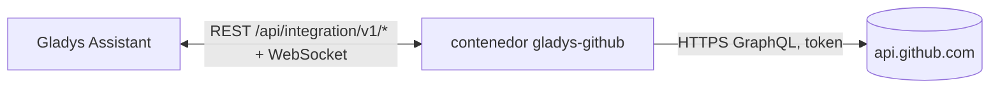
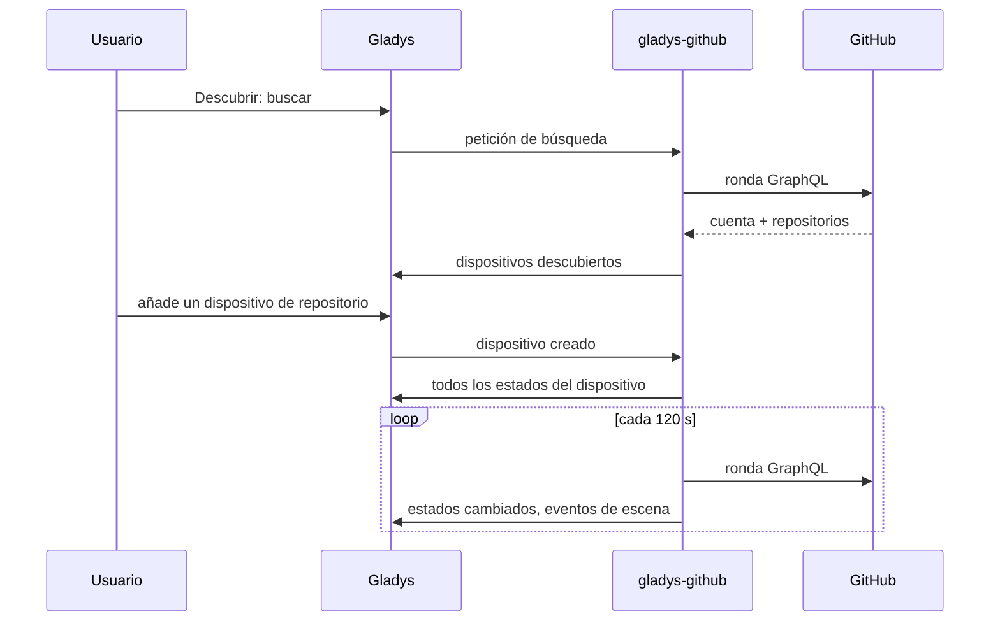

# Gladys GitHub

[English](README.md) · [Français](README.fr.md) · [Deutsch](README.de.md) · **Español**

[](LICENSE)
[](https://github.com/William-De71/gladys-github/releases)
[](https://github.com/William-De71/gladys-github/actions/workflows/release.yml)
[](https://gladysassistant.com)


Una integración externa para [Gladys Assistant](https://gladysassistant.com) que sigue repositorios de GitHub, como la integración GitHub de Home Assistant. Versiones, issues, pull requests, estrellas y resultados de CI se convierten en dispositivos, disparadores de escena y widgets del panel.

## Funciones

- Un **dispositivo por repositorio**: estrellas, forks, seguidores, issues abiertas, pull requests abiertas y fusionadas, discusiones, descargas de la última versión; como texto la última versión, etiqueta, commit, issue, pull request y discusión.
- Un **dispositivo para tu cuenta**: seguidores, seguidos, repositorios y gists públicos.
- **7 disparadores de escena**: versión publicada, issue abierta, pull request abierta, discusión iniciada, nuevo commit, nueva estrella, comprobaciones (CI) superadas o fallidas.
- **1 acción de escena**: leer las cifras de un repositorio en una escena.
- **3 widgets del panel**: un repositorio, la actividad reciente, tu cuenta y su cuota de API.
- Repositorios públicos, y privados si el token tiene acceso. Solo lectura: la integración nunca escribe en GitHub.
- Inglés, francés, alemán y español en todas partes.

## Funcionamiento




Cada ronda lee la cuenta, la cuota de API y cada repositorio seguido con una petición GraphQL por lote de 10 repositorios (1 punto cada una, de los 5000 puntos por hora que GitHub concede a un token). La primera ronda tras un arranque sirve de referencia: las transiciones se notifican a partir de la ronda siguiente.



### Transporte

Solo **nube** (`"transports": ["cloud"]`): la integración solo habla con `api.github.com`. Gladys muestra la insignia Nube en el catálogo. Los nombres de los repositorios seguidos y el token salen de tu red hacia GitHub; nada va a ningún otro sitio.

## Dispositivos y funciones

| Dispositivo         | Función                                                           | Tipo                            |
| ------------------- | ----------------------------------------------------------------- | ------------------------------- |
| GitHub `owner/name` | Estrellas, Forks, Seguidores                                      | Contador                        |
|                     | Issues abiertas, pull requests abiertas / fusionadas, Discusiones | Contador                        |
|                     | Descargas de la última versión                                    | Contador (versión con archivos) |
|                     | Última versión, etiqueta, commit                                  | Texto                           |
|                     | Última issue, pull request, discusión                             | Texto                           |
| GitHub `@login`     | Seguidores, Siguiendo, Repositorios públicos, Gists públicos      | Contador                        |

Los identificadores externos se basan en los identificadores numéricos de GitHub: renombrar o transferir un repositorio conserva su dispositivo.

## Disparadores, acción y widgets

| Tipo       | Clave                 | Uso                                                       |
| ---------- | --------------------- | --------------------------------------------------------- |
| Disparador | `release_published`   | Sale una versión o versión preliminar (filtro por tipo)   |
| Disparador | `issue_opened`        | Alguien abre una issue                                    |
| Disparador | `pull_request_opened` | Alguien abre una pull request                             |
| Disparador | `discussion_created`  | Alguien inicia una discusión                              |
| Disparador | `commit_pushed`       | Llega un commit a la rama predeterminada                  |
| Disparador | `star_added`          | Aumenta el número de estrellas                            |
| Disparador | `checks_completed`    | La CI del último commit se supera o falla (filtro)        |
| Acción     | `get_repository`      | Estrellas, issues, última versión… como salidas de escena |
| Widget     | `repository`          | Un repositorio de un vistazo                              |
| Widget     | `activity`            | Últimas versiones, issues, pull requests y commits        |
| Widget     | `account`             | Seguidores, repositorios, cuota de API restante           |

Ejemplos de escenas:

- Cuando sale una versión de un proyecto que usas → envía un mensaje con `{{triggerEvent.data.summary}}`.
- Cuando fallan las comprobaciones de tu proyecto → pon en rojo la lámpara del despacho.
- Cuando tu repositorio recibe una estrella → reproduce un sonido en el altavoz.


## Requisitos

- Gladys Assistant **5.1.0** o posterior (widgets y escenas de las integraciones externas). Las instancias anteriores no pueden instalarla.
- Un token de acceso personal de GitHub: de grano fino con «Public repositories» (solo lectura), o con acceso de lectura a los repositorios privados elegidos.

## Instalación

- **Desde la tienda**: Integraciones → buscar «GitHub» → Instalar.
- **Desde la URL del repositorio**: Integraciones → Instalar una integración → `https://github.com/William-De71/gladys-github`.
- **Modo desarrollador**: Integraciones → Instalar una integración → Modo desarrollador, con la imagen `ghcr.io/william-de71/gladys-github:<version>`.

## Configuración

| Campo                    | Obligatorio | Descripción                                                                                                                          |
| ------------------------ | ----------- | ------------------------------------------------------------------------------------------------------------------------------------ |
| Token de acceso personal | Sí          | Guardado como secreto, nunca en los registros                                                                                        |
| Repositorios a seguir    | No          | `propietario/nombre`, enlaces de github.com o patrones `propietario/*` / `propietario/prefijo*`, separados por comas, 50 como máximo |
| Intervalo de lectura (s) | No          | De 60 a 3600, 120 por defecto                                                                                                        |
| Idioma de los textos     | No          | Nombres de dispositivos y resúmenes de escenas; automático por defecto                                                               |

**Probar la conexión** muestra la cuenta, la cuota de API restante y los repositorios leídos.

## Uso

1. Indica el token y los repositorios y guarda.
2. Dispositivos → GitHub → Descubrir: añade los repositorios y tu cuenta.
3. Escenas: elige un disparador de GitHub, filtra por un dispositivo de repositorio, usa las variables en un mensaje.
4. Panel: añade un widget de GitHub.

La documentación de usuario está en [docs/es.md](docs/es.md) ([en](docs/en.md), [fr](docs/fr.md), [de](docs/de.md)).

## Desarrollo

```bash
npm install
npm test                 # node --test, nunca usa la red
npm run lint             # ESLint
npm run format:check     # Prettier
npx github:GladysAssistant/integration-store . --skip-image-check
scripts/build-cover.sh   # cover.jpg desde docs/assets/cover.svg
```

En local, el SDK lee `GLADYS_HOST_API_URL`, `GLADYS_INTEGRATION_TOKEN` y `GLADYS_INTEGRATION_SELECTOR` (que Gladys proporciona en modo desarrollador). `DEBUG=gladys-integration-sdk` muestra los registros del SDK.

Las pruebas cubren el cliente GraphQL, la lectura de las respuestas, las transiciones, los dispositivos (los campos que exige la pestaña Descubrir), los widgets (`validateWidgetContent`), el manifiesto, los cuatro idiomas, el script de versiones y la integración completa frente al Gladys simulado del SDK. `test/structure.test.js` congela todas las claves que guardan los usuarios.

## Proceso de versiones


Cada fusión en `main` lanza la CI y calcula la versión a partir de los [Conventional Commits](https://www.conventionalcommits.org/es/) desde la última etiqueta: `feat` → menor, `fix` / `perf` → parche, `!` o `BREAKING CHANGE` → mayor (menor antes de 1.0.0); `docs`, `chore`, `ci`, `test`, `style`, `refactor`, `build` solos no publican nada. Se genera la sección del changelog, se envía la etiqueta, se construye la imagen multiarquitectura, después `main` recibe el commit de versión, se crea la GitHub Release y un último job comprueba la imagen pública, el validador de la tienda y el topic.

- El título de la pull request se convierte en el commit de squash y luego en la línea del changelog: escríbelo en inglés, para el usuario (`pr-title.yml` lo comprueba). Nunca edites `CHANGELOG.md` a mano.
- La 1.0.0 es una decisión: Actions → Release → Run workflow con `release-as: 1.0.0`. `dry-run` muestra la versión y las notas sin publicar nada.
- **Rama protegida**: la versión envía su commit a `main` con `GITHUB_TOKEN`. Con un ruleset en `main`, añade GitHub Actions a su lista de excepciones (o envía mediante una GitHub App); si no, el job de publicación falla explicando qué hacer.
- Tras la primera versión, haz público el paquete `ghcr.io` (Package settings → Change visibility), o Gladys no podrá descargarlo.

## Solución de problemas

Consulta [docs/es.md](docs/es.md#solución-de-problemas). Informa de los problemas con las versiones de Gladys y de la integración y los registros (`DEBUG=gladys-integration-sdk`).

## Contribuir

Las issues y pull requests son bienvenidas. Ejecuta `npm run format:check && npm run lint && npm test` antes de abrir una pull request, y no cambies ningún identificador externo ni ninguna clave guardada (consulta [CLAUDE.md](CLAUDE.md)).

## Seguridad

Consulta [SECURITY.md](SECURITY.md): informa de las vulnerabilidades en privado. El token es un campo `secret`, nunca registrado; basta con un token de solo lectura.

## Capturas próximamente

Las imágenes de arriba son ilustraciones, no capturas. Las capturas reales irán en `docs/assets/screenshots/` (PNG, 1280 × 800): `configuration.png`, `discovery.png`, `widgets.png`, `scene.png`.

## Licencia

[Licencia Apache 2.0](LICENSE) — consulta también [NOTICE](NOTICE). GitHub es una marca de GitHub, Inc.; esta integración comunitaria no está afiliada a GitHub. Gracias a la documentación y al SDK de Gladys.
