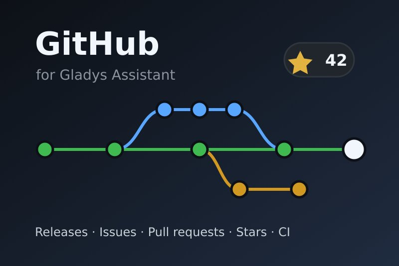
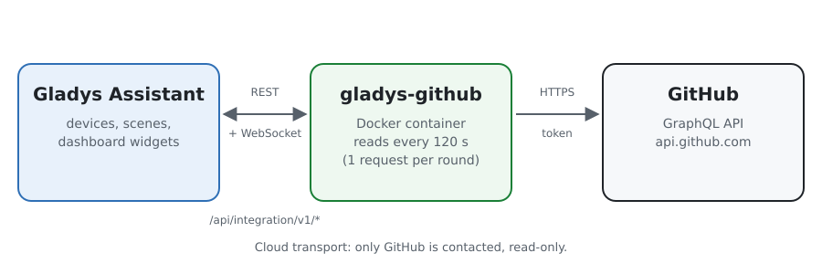
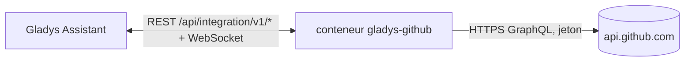
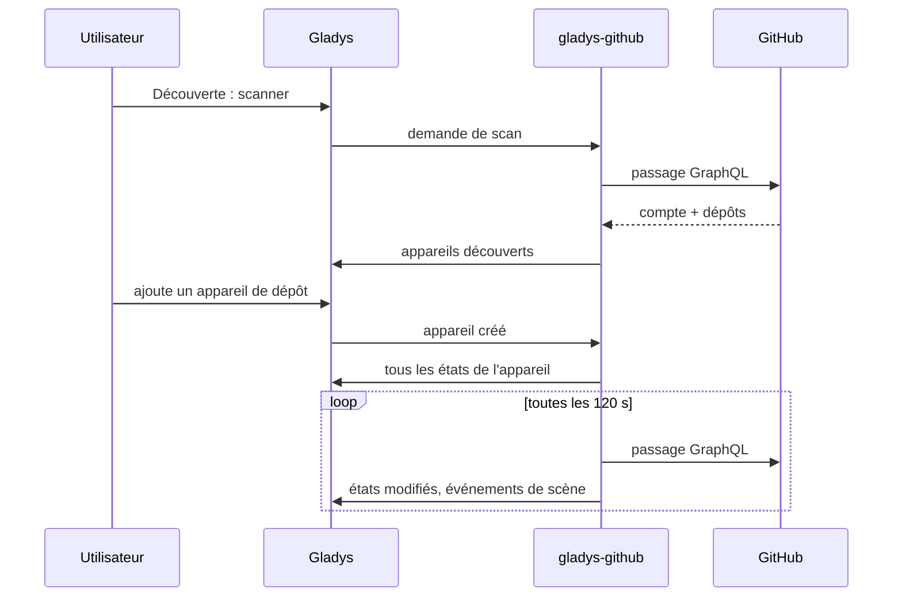
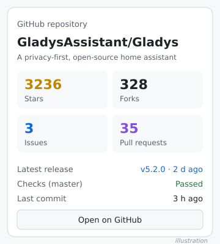
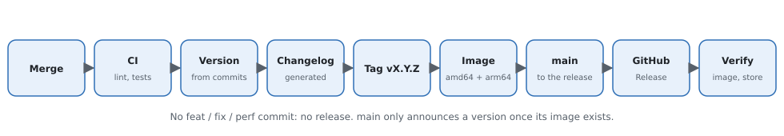

# Gladys GitHub

[English](README.md) · **Français** · [Deutsch](README.de.md) · [Español](README.es.md)

[](LICENSE)
[](https://github.com/William-De71/gladys-github/releases)
[](https://github.com/William-De71/gladys-github/actions/workflows/release.yml)
[](https://gladysassistant.com)



Une intégration externe pour [Gladys Assistant](https://gladysassistant.com) qui suit des dépôts GitHub, comme l'intégration GitHub de Home Assistant. Versions, issues, pull requests, étoiles et résultats de CI deviennent des appareils, des déclencheurs de scène et des widgets de tableau de bord.

## Fonctionnalités

- Un **appareil par dépôt** : étoiles, forks, abonnés, issues ouvertes, pull requests ouvertes et fusionnées, discussions, téléchargements de la dernière version ; en texte la dernière version, le dernier tag, commit, issue, pull request et discussion.
- Un **appareil pour votre compte** : abonnés, abonnements, dépôts et gists publics.
- **7 déclencheurs de scène** : version publiée, issue ouverte, pull request ouverte, discussion lancée, nouveau commit, nouvelle étoile, vérifications (CI) réussies ou en échec.
- **1 action de scène** : lire les chiffres d'un dépôt dans une scène.
- **3 widgets** : un dépôt, l'activité récente, votre compte et son quota d'API.
- Dépôts publics, et privés si le jeton y a accès. Lecture seule : l'intégration n'écrit jamais sur GitHub.
- Anglais, français, allemand et espagnol partout.

## Fonctionnement





Une requête GraphQL par passage lit le compte, le quota d'API et chaque dépôt suivi (1 point sur les 5 000 points par heure que GitHub accorde à un jeton). Le premier passage après un démarrage sert de référence : les transitions sont signalées à partir du passage suivant.



### Transport

**Cloud** uniquement (`"transports": ["cloud"]`) : l'intégration ne parle qu'à `api.github.com`. Gladys affiche le badge Cloud dans le catalogue. Les noms des dépôts suivis et le jeton sortent de votre réseau vers GitHub ; rien ne part ailleurs.

## Appareils et fonctionnalités

| Appareil            | Fonctionnalité                                                    | Type                             |
| ------------------- | ----------------------------------------------------------------- | -------------------------------- |
| GitHub `owner/name` | Étoiles, Forks, Abonnés                                           | Compteur                         |
|                     | Issues ouvertes, Pull requests ouvertes / fusionnées, Discussions | Compteur                         |
|                     | Téléchargements de la dernière version                            | Compteur (version avec fichiers) |
|                     | Dernière version, tag, commit                                     | Texte                            |
|                     | Dernière issue, pull request, discussion                          | Texte                            |
| GitHub `@login`     | Abonnés, Abonnements, Dépôts publics, Gists publics               | Compteur                         |

Les identifiants externes reposent sur les identifiants numériques de GitHub : renommer ou transférer un dépôt conserve son appareil.

## Déclencheurs, action et widgets

| Type        | Clé                   | Usage                                                  |
| ----------- | --------------------- | ------------------------------------------------------ |
| Déclencheur | `release_published`   | Une version ou préversion sort (filtre sur le type)    |
| Déclencheur | `issue_opened`        | Quelqu'un ouvre une issue                              |
| Déclencheur | `pull_request_opened` | Quelqu'un ouvre une pull request                       |
| Déclencheur | `discussion_created`  | Quelqu'un lance une discussion                         |
| Déclencheur | `commit_pushed`       | Un commit arrive sur la branche par défaut             |
| Déclencheur | `star_added`          | Le nombre d'étoiles augmente                           |
| Déclencheur | `checks_completed`    | La CI du dernier commit réussit ou échoue (filtre)     |
| Action      | `get_repository`      | Étoiles, issues, dernière version… en sorties de scène |
| Widget      | `repository`          | Un dépôt en un coup d'œil                              |
| Widget      | `activity`            | Dernières versions, issues, pull requests et commits   |
| Widget      | `account`             | Abonnés, dépôts, quota d'API restant                   |

Exemples de scènes :

- Quand une version d'un projet que vous utilisez sort → envoyez un message avec `{{triggerEvent.data.summary}}`.
- Quand les vérifications de votre projet échouent → passez la lampe du bureau en rouge.
- Quand votre dépôt reçoit une étoile → jouez un son sur l'enceinte.



## Prérequis

- Gladys Assistant **5.1.0** ou plus récent (widgets et scènes des intégrations externes). Les instances plus anciennes ne peuvent pas l'installer.
- Un jeton d'accès personnel GitHub : à granularité fine avec « Public repositories » (lecture seule), ou avec un accès en lecture aux dépôts privés choisis.

## Installation

- **Depuis le store** : Intégrations → chercher « GitHub » → Installer.
- **Depuis l'URL du dépôt** : Intégrations → Installer une intégration → `https://github.com/William-De71/gladys-github`.
- **Mode développeur** : Intégrations → Installer une intégration → Mode développeur, avec l'image `ghcr.io/william-de71/gladys-github:<version>`.

## Configuration

| Champ                     | Obligatoire | Description                                                                                                                        |
| ------------------------- | ----------- | ---------------------------------------------------------------------------------------------------------------------------------- |
| Jeton d'accès personnel   | Oui         | Stocké comme secret, jamais journalisé                                                                                             |
| Dépôts à suivre           | Non         | `propriétaire/nom`, liens github.com ou motifs `propriétaire/*` / `propriétaire/préfixe*`, séparés par des virgules, 20 au maximum |
| Intervalle de lecture (s) | Non         | De 60 à 3600, 120 par défaut                                                                                                       |
| Langue des textes         | Non         | Noms des appareils et résumés des scènes ; automatique par défaut                                                                  |

**Tester la connexion** affiche le compte, le quota d'API restant et les dépôts lus.

## Utilisation

1. Renseignez le jeton et les dépôts, puis enregistrez.
2. Appareils → GitHub → Découverte : ajoutez les dépôts et votre compte.
3. Scènes : choisissez un déclencheur GitHub, filtrez sur un appareil de dépôt, utilisez les variables dans un message.
4. Tableau de bord : ajoutez un widget GitHub.

La documentation utilisateur est dans [docs/fr.md](docs/fr.md) ([en](docs/en.md), [de](docs/de.md), [es](docs/es.md)).

## Développement

```bash
npm install
npm test                 # node --test, ne touche jamais le réseau
npm run lint             # ESLint
npm run format:check     # Prettier
npx github:GladysAssistant/integration-store . --skip-image-check
scripts/build-cover.sh   # cover.jpg depuis docs/assets/cover.svg
```

En local, le SDK lit `GLADYS_HOST_API_URL`, `GLADYS_INTEGRATION_TOKEN` et `GLADYS_INTEGRATION_SELECTOR` (fournis par Gladys en mode développeur). `DEBUG=gladys-integration-sdk` affiche les journaux du SDK.

Les tests couvrent le client GraphQL, la lecture des réponses, les transitions, les appareils (les champs exigés par l'écran de découverte), les widgets (`validateWidgetContent`), le manifeste, les quatre langues, le script de release, et l'intégration complète face au faux Gladys du SDK. `test/structure.test.js` fige toutes les clés stockées côté utilisateur.

## Processus de release



Chaque fusion sur `main` lance la CI, puis calcule la version à partir des [Conventional Commits](https://www.conventionalcommits.org/fr/) depuis le dernier tag : `feat` → mineure, `fix` / `perf` → correctif, `!` ou `BREAKING CHANGE` → majeure (mineure avant 1.0.0) ; `docs`, `chore`, `ci`, `test`, `style`, `refactor`, `build` seuls ne publient rien. La section du changelog est générée, le tag poussé, l'image multi-architecture construite, puis `main` reçoit le commit de release, la GitHub Release est créée et un dernier job vérifie l'image publique, le validateur du store et le topic.

- Le titre de la pull request devient le commit de squash, puis la ligne du changelog : écrivez-le en anglais, pour l'utilisateur (`pr-title.yml` le vérifie). Ne modifiez jamais `CHANGELOG.md` à la main.
- La 1.0.0 est une décision : Actions → Release → Run workflow avec `release-as: 1.0.0`. `dry-run` affiche la version et les notes sans rien publier.
- **Branche protégée** : la release pousse son commit sur `main` avec `GITHUB_TOKEN`. Avec un ruleset sur `main`, ajoutez GitHub Actions à sa liste de contournement (ou passez par une GitHub App), sinon le job de publication échoue en expliquant quoi faire.
- Après la première release, rendez public le package `ghcr.io` (Package settings → Change visibility), sinon Gladys ne peut pas le télécharger.

## Dépannage

Voir [docs/fr.md](docs/fr.md#dépannage). Signalez les problèmes avec les versions de Gladys et de l'intégration et les journaux (`DEBUG=gladys-integration-sdk`).

## Contribuer

Issues et pull requests bienvenues. Lancez `npm run format:check && npm run lint && npm test` avant d'ouvrir une pull request, et ne changez aucun identifiant externe ni aucune clé stockée (voir [CLAUDE.md](CLAUDE.md)).

## Sécurité

Voir [SECURITY.md](SECURITY.md) : signalez les failles en privé. Le jeton est un champ `secret`, jamais journalisé ; un jeton en lecture seule suffit.

## Captures à venir

Les images ci-dessus sont des illustrations, pas des captures. Les vraies captures iront dans `docs/assets/screenshots/` (PNG, 1280 × 800) : `configuration.png`, `discovery.png`, `widgets.png`, `scene.png`.

## Licence

[Licence Apache 2.0](LICENSE) — voir aussi [NOTICE](NOTICE). GitHub est une marque de GitHub, Inc. ; cette intégration communautaire n'est pas affiliée à GitHub. Merci à la documentation et au SDK de Gladys.
