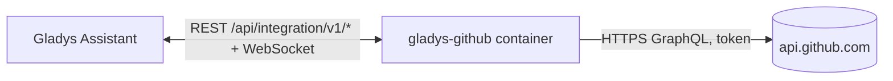
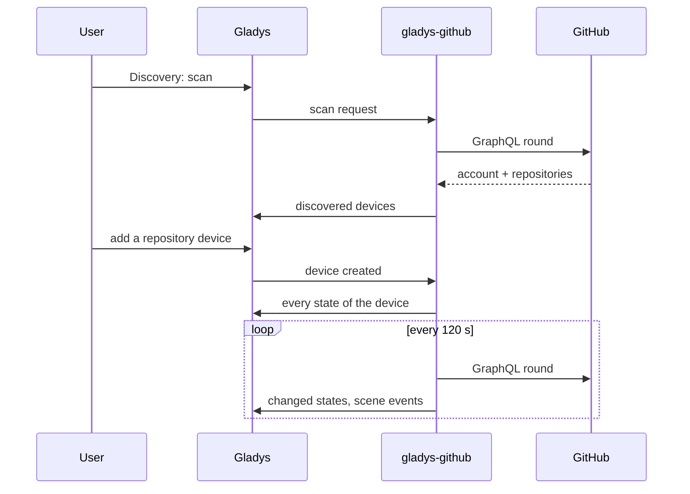

# Gladys GitHub

**English** · [Français](README.fr.md) · [Deutsch](README.de.md) · [Español](README.es.md)

[](LICENSE)
[](https://github.com/William-De71/gladys-github/releases)
[](https://github.com/William-De71/gladys-github/actions/workflows/release.yml)
[](https://gladysassistant.com)


An external integration for [Gladys Assistant](https://gladysassistant.com) that follows GitHub repositories, like the GitHub integration of Home Assistant. Releases, issues, pull requests, stars and CI results become devices, scene triggers and dashboard widgets.

## Features

- A **device per repository**: stars, forks, watchers, open issues, open and merged pull requests, discussions, downloads of the latest release; the latest release, tag, commit, issue, pull request and discussion as texts.
- A **device for your account**: followers, following, public repositories and gists.
- **7 scene triggers**: release published, issue opened, pull request opened, discussion started, new commit, new star, checks (CI) passed or failed.
- **1 scene action**: read a repository's figures in a scene.
- **3 dashboard widgets**: a repository, the latest activity, your account and its API quota.
- Public repositories, and private ones the token can read. Read-only: the integration never writes to GitHub.
- English, French, German and Spanish everywhere.

## How it works




Each round reads the account, the API quota and every followed repository with one GraphQL request per batch of 10 repositories (1 point each, of the 5,000 points an hour GitHub grants to a token). The first round after a start is a reference: the transitions are reported from the next round on.



### Transport

**Cloud** only (`"transports": ["cloud"]`): the integration talks to `api.github.com` and nothing else. Gladys shows the Cloud badge in the catalog. The names of the followed repositories and the token leave your network for GitHub; nothing goes anywhere else.

## Devices and features

| Device              | Feature                                                 | Type                         |
| ------------------- | ------------------------------------------------------- | ---------------------------- |
| GitHub `owner/name` | Stars, Forks, Watchers                                  | Counter                      |
|                     | Open issues, Open / merged pull requests, Discussions   | Counter                      |
|                     | Latest release downloads                                | Counter (release with files) |
|                     | Latest release, tag, commit                             | Text                         |
|                     | Latest issue, pull request, discussion                  | Text                         |
| GitHub `@login`     | Followers, Following, Public repositories, Public gists | Counter                      |

External ids rely on the numeric ids of GitHub: renaming or transferring a repository keeps its device.

## Scene triggers, action and widgets

| Kind    | Key                   | Use                                                   |
| ------- | --------------------- | ----------------------------------------------------- |
| Trigger | `release_published`   | A release or pre-release is out (filter on the type)  |
| Trigger | `issue_opened`        | Someone opens an issue                                |
| Trigger | `pull_request_opened` | Someone opens a pull request                          |
| Trigger | `discussion_created`  | Someone starts a discussion                           |
| Trigger | `commit_pushed`       | A commit lands on the default branch                  |
| Trigger | `star_added`          | The star count goes up                                |
| Trigger | `checks_completed`    | The CI of the latest commit passed or failed (filter) |
| Action  | `get_repository`      | Stars, issues, latest release… as scene outputs       |
| Widget  | `repository`          | One repository at a glance                            |
| Widget  | `activity`            | Latest releases, issues, pull requests and commits    |
| Widget  | `account`             | Followers, repositories, API quota left               |

Scene examples:

- When a release of a project you use is published → send a message with `{{triggerEvent.data.summary}}`.
- When the checks of your project fail → turn the office lamp red.
- When your repository gets a new star → play a sound on the speaker.


## Requirements

- Gladys Assistant **5.3.0** or later (widgets and scenes of external integrations, catalog keywords of Gladys 5.3). Older instances cannot install it.
- A GitHub personal access token: fine-grained with "Public repositories" (read-only), or with read-only access to the chosen private repositories.

## Installation

- **From the store**: Integrations → search "GitHub" → Install.
- **From the repository URL**: Integrations → Install an integration → `https://github.com/William-De71/gladys-github`.
- **Developer mode**: Integrations → Install an integration → Developer mode, with the image `ghcr.io/william-de71/gladys-github:<version>`.

## Configuration

| Field                  | Required | Description                                                                                             |
| ---------------------- | -------- | ------------------------------------------------------------------------------------------------------- |
| Personal access token  | Yes      | Stored as a secret, never logged                                                                        |
| Repositories to follow | No       | `owner/name`, github.com links or `owner/*` / `owner/prefix*` patterns, separated by commas, 50 at most |
| Refresh interval (s)   | No       | 60 to 3600, 120 by default                                                                              |
| Language of the texts  | No       | Device names and scene summaries; automatic by default                                                  |

**Test the connection** shows the account, the API quota left and the repositories read.

## Usage

1. Configure the token and the repositories, then save.
2. Devices → GitHub → Discovery: add the repositories and your account.
3. Scenes: pick a GitHub trigger, filter on a repository device, use the variables in a message.
4. Dashboard: add a GitHub widget.

The user documentation is in [docs/en.md](docs/en.md) ([fr](docs/fr.md), [de](docs/de.md), [es](docs/es.md)).

## Development

```bash
npm install
npm test                 # node --test, never touches the network
npm run lint             # ESLint
npm run format:check     # Prettier
npx github:GladysAssistant/integration-store . --skip-image-check
scripts/build-cover.sh   # cover.jpg from docs/assets/cover.svg
```

Locally, the SDK reads `GLADYS_HOST_API_URL`, `GLADYS_INTEGRATION_TOKEN` and `GLADYS_INTEGRATION_SELECTOR` (given by Gladys in developer mode). `DEBUG=gladys-integration-sdk` shows the SDK logs.

The tests cover the GraphQL client, the reading of the answers, the transitions, the devices (the fields the Discovery screen requires), the widgets (`validateWidgetContent`), the manifest, the four languages, the release script, and the whole integration against the fake Gladys of the SDK. `test/structure.test.js` freezes every key users store.

## Release process


Every merge on `main` runs the CI, then computes the version from the [Conventional Commits](https://www.conventionalcommits.org/) since the last tag: `feat` → minor, `fix` / `perf` → patch, `!` or `BREAKING CHANGE` → major (a minor below 1.0.0); `docs`, `chore`, `ci`, `test`, `style`, `refactor`, `build` alone publish nothing. The changelog section is generated, the tag pushed, the multi-architecture image built, then `main` receives the release commit, the GitHub Release is created and a last job checks the public image, the store validator and the topic.

- The pull request title becomes the squash commit, then the changelog line: write it in English, for the user (`pr-title.yml` checks it). Never edit `CHANGELOG.md` by hand.
- 1.0.0 is a decision: Actions → Release → Run workflow with `release-as: 1.0.0`. `dry-run` shows the version and the notes without publishing.
- **Protected branch**: the release pushes its commit to `main` with `GITHUB_TOKEN`. With a ruleset on `main`, add GitHub Actions to its bypass list (or push through a GitHub App), otherwise the publish job fails with instructions.
- After the first release, make the `ghcr.io` package public (Package settings → Change visibility), or Gladys cannot pull it.

## Troubleshooting

See [docs/en.md](docs/en.md#troubleshooting). Report issues with the Gladys and integration versions and the logs (`DEBUG=gladys-integration-sdk`).

## Contributing

Issues and pull requests are welcome. Run `npm run format:check && npm run lint && npm test` before opening a pull request, and keep every external id and stored key unchanged (see [CLAUDE.md](CLAUDE.md)).

## Security

See [SECURITY.md](SECURITY.md): report vulnerabilities privately. The token is a `secret` field, never logged; a read-only token is enough.

## Screenshots to come

The images above are illustrations, not screenshots. Real screenshots will go in `docs/assets/screenshots/` (PNG, 1280 × 800): `configuration.png`, `discovery.png`, `widgets.png`, `scene.png`.

## License

[Apache License 2.0](LICENSE) — see also [NOTICE](NOTICE). GitHub is a trademark of GitHub, Inc.; this community integration is not affiliated with GitHub. Thanks to the Gladys documentation and SDK.
